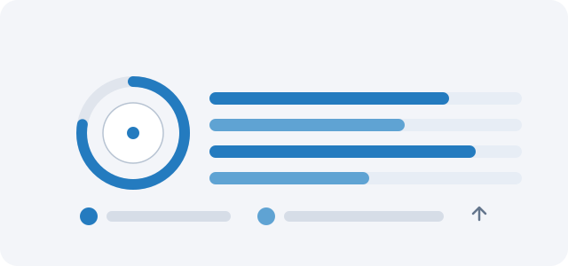

Open the workbench page from the **SEO 分析** row in the left navigation sidebar, or from the same-name tab in the right sidebar, and run a technical SEO audit of any website.

What gets checked (four weighted groups):

- **Crawlability & indexing** — HTTP status and redirects, robots.txt, sitemap discovery, canonical tags, meta robots
- **Technical foundations** — HTTPS, mixed content, mobile viewport, HTML lang, page weight
- **On-Page** — title and meta description length, H1 structure, image alt text, lazy loading, JSON-LD structured data
- **Content quality** — content thickness, duplicate title/description

The audit produces a weighted 0–100 total score plus per-group scores, a prioritized issue list formatted as impact → evidence → fix, and a one-click Markdown export.

The **deep check** button pulls real Core Web Vitals (LCP / CLS / INP / TTFB / FCP) and Lighthouse category scores from Google PageSpeed Insights, and acts as a fallback detector for JavaScript-injected JSON-LD.

Notes: analysis is based on the server-rendered HTML (no JavaScript execution), and single-page analysis cannot detect cross-page duplicate titles.