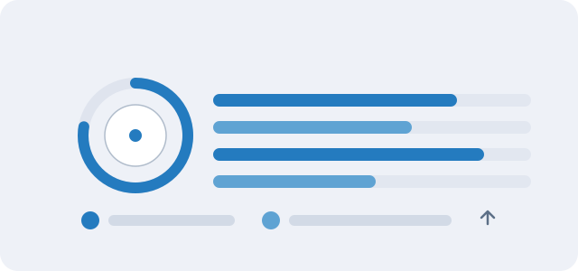

在右侧边栏直接对任意网址做一次技术 SEO 体检。

检查范围（四个加权分组）：

- **可抓取与索引** — HTTP 状态与重定向、robots.txt、sitemap 发现、canonical、meta robots
- **技术基础** — HTTPS、混合内容、移动端 viewport、html lang、页面体积
- **On-Page** — 标题与描述长度、H1 结构、图片 alt、懒加载、JSON-LD 结构化数据
- **内容质量** — 内容厚度、标题与描述重复

分析输出 0–100 加权总分与分组得分，按「影响 → 证据 → 修复」列出问题清单，并支持一键导出 Markdown 报告。

「深度检测」通过 Google PageSpeed Insights 拉取真实 Core Web Vitals（LCP / CLS / INP / TTFB / FCP）与 Lighthouse 评分，并兜底检测 JS 注入的 JSON-LD。

注意：检测基于服务端返回的 HTML（不执行浏览器 JS）；单页分析无法判断跨页重复的标题/描述。